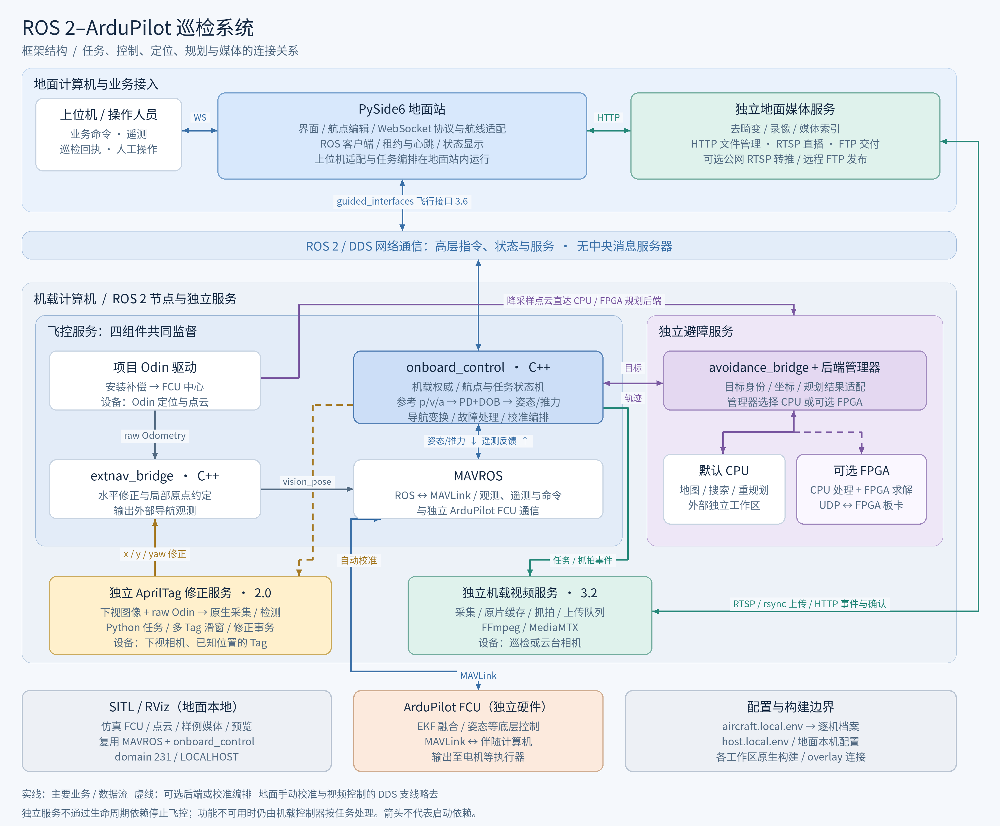

<!-- 项目运行架构、数据流、服务边界与开发修改入口。 -->
# 项目架构

本项目是一套基于 ROS 2 的无人机巡检系统：地面站承接人工操作和上位机任务，机载控制器执行航点与轨迹跟踪，ArduPilot 完成底层飞控。Odin 定位、避障规划、AprilTag 修正和媒体处理通过明确接口连接；实机与 SITL 复用机载控制器及高层协议。

## 框架结构

图中箭头表示主要业务或数据流；同一框内可能包含多个进程。ROS 2/DDS 是分布式通信机制，项目没有单独的中央 ROS 消息服务器。图中省略参数服务、诊断和部分状态回传，具体接口见下表。

## 模块职责与代码位置

| 层次 / 模块 | 主要职责 | 实现入口 |
| --- | --- | --- |
| 地面站 | PySide6 界面、航点编辑、连接与租约、状态显示；ROS 客户端发送高层意图 | [ground_station.py](../ground_station.py)、[qt_ui/](../ground_station_core/qt_ui/)、[ros_controller.py](../ground_station_core/ros_controller.py) |
| 上位机接入 | WebSocket 协议、命令映射、航线适配、巡检编排及结果回传；运行在地面站内 | [upstream/](../ground_station_core/upstream/)、[route_profiles/](../config/ground/route_profiles/) |
| 机载控制器 | 控制权、任务状态机、导航坐标转换、参考生成、PD+DOB 跟踪、故障处理与自动校准编排 | [onboard_control/src/](../src/onboard_control/src/) |
| MAVROS / ArduPilot | MAVROS 转换 ROS 与 MAVLink；ArduPilot 负责 EKF、姿态等底层控制与执行器输出 | [MAVROS 配置](../config/mavros/)、[启动组件](../scripts/onboard/components/)；MAVROS 与 ArduPilot 为外部依赖 |
| Odin 驱动 | 接入设备定位与点云，在发布层处理固定安装外参，输出 FCU 中心里程计和降采样点云 | [drivers/odin/](../drivers/odin/) |
| extnav 桥 | 接收原始 Odin 里程计，应用水平修正及原点约定，向 MAVROS 提供外部导航观测 | [extnav_patch/](../correction_service/extnav_patch/)；生产包为 `extnav_bridge` |
| 避障桥与 CPU 规划器 | 桥适配目标身份、坐标和规划结果；独立 CPU 工程负责地图、搜索、重规划和轨迹计算 | [avoidance_bridge/](../src/avoidance_bridge/)；外部工作区由 `AVOIDANCE_WORKSPACE` 指定 |
| 可选 FPGA 后端 | 复用规划协议，以 CPU A* 与 FPGA Ising/QUBO 后端生成候选及可执行轨迹 | [fpga_avoidance/](../fpga_avoidance/)；独立源码、Python 环境和构建产物 |
| AprilTag 修正 | 下视图像与原始 Odin 数据配对、Tag 位姿估计、多 Tag 滑窗求解及修正事务 | [correction_service/](../correction_service/)、[correction_native/](../src/correction_native/) |
| 机载视频 | 相机采集、推流、本地缓存、抓拍及上传队列；消费机载任务事件 | [onboard_video_node.py](../video_service/onboard_video_node.py)、[camera_service.py](../video_service/camera_service.py)、[onboard_media.py](../video_service/onboard_media.py) |
| 地面媒体 | 接收原始流、去畸变、直播与录像、媒体索引及文件交付；独立于 GUI | [ground_media.py](../video_service/ground_media.py)、[ground_relay.py](../video_service/ground_relay.py)、[media_store.py](../video_service/media_store.py) |
| SITL 与预览 | 编排本地 ArduPilot SITL、MAVROS、机载控制器与避障演示；RViz 显示模型和轨迹 | [environment.py](../ground_station_core/environment.py)、[guided_sim/](../src/guided_sim/) |

## 主要数据流

### 飞行任务与控制闭环

1. 人工操作或上位机命令进入地面站。上位机航线可先经 `route_adapter.py` 生成执行副本，保留业务点号与照片编号映射。
2. `GroundStationRosController` 申请控制租约、发送心跳，并通过共享服务提交飞行指令或航点任务。
3. `onboard_control` 检查权威状态，管理任务进度，将任务坐标转换到 FCU 本地坐标，生成位置、速度、加速度参考。
4. 轨迹跟踪器根据参考及反馈计算姿态和归一化推力，经 `/mavros/setpoint_raw/attitude` 发送给 MAVROS，再由 MAVLink 进入 ArduPilot。起飞、降落等离散操作还使用对应 MAVROS 服务。
5. FCU 遥测经 MAVROS 返回机载控制器；`ControlStatus`、`CommandResult` 等再供地面站显示和上位机结果编排使用。

**地面站不承担固定周期飞行控制；规划器也不直接输出飞控 setpoint。** 机载控制器是项目姿态 setpoint 的唯一输出源，ArduPilot 仍承担底层控制。租约、任务状态和故障处理均由机载权威执行，GUI 状态只是投影。

### 定位与 AprilTag 修正

Odin 设备经项目驱动输出 `/odin1/odometry_highfreq`，其 pose 为 `odom ← fcu`，参考点在 FCU 中心，twist 在 FCU 机体系。固定安装角和杆臂只在驱动中补偿，下游不重复处理。

`extnav_bridge` 将 raw 里程计转换为最终外部导航观测，发布 `/mavros/vision_pose/pose`；ArduPilot EKF 融合后，再通过 MAVROS 返回本地位姿和速度。raw Odin、extnav 输出与 FCU 融合输出是三个不同阶段的数据。

有下视相机时，`correction_native` 负责原生接收、采集及视觉热路径，Python `correction_service` 负责采样任务、滑窗、候选和事务。它使用**未经 Tag 修正的 raw Odin**与图像配对，结合相机标定及已知 Tag 位置求水平 `x/y/yaw` 修正，经 `SetCorrection` 写入 extnav；session/revision 用于核对修正身份。该模块不修正世界高度。

手动校准来自独立面板；航点自动校准由 `waypoint_calibration.cpp` 编排：到点后申请校准资源、采样并应用，再等待 FCU 融合一致后推进航点。修正服务 ACK 与 FCU 已融合是两种不同状态。坐标细节见 [odom/map](odom-map.md)，业务限制见 [Tag 工作流](tag-waypoint-workflow.md)。

### 避障规划与轨迹执行

机载控制器将业务目标送给 `avoidance_bridge`。桥把 FCU 状态和目标转换到规划坐标，交给原生规划器，并将结果中的轨迹段转换回控制坐标。桥自身不建图、不搜索，也不按自己的周期替规划器重规划。

默认 CPU 规划器位于仓库外的独立 `dyn_small_obs_avoidance-ros2` 工作区，读取 Odin 降采样点云及桥适配后的里程计，负责地图与搜索。控制器消费多项式轨迹及其限额，负责实际跟踪和航点到达判定。直线、遇障悬停、自主避障三种策略在控制器中衔接；普通直线任务不依赖规划器。

FPGA 模块是可移除的另一后端，内部仍包含 CPU 处理，真实求解来源可能为直接路径、CPU 回退或 FPGA 参与。管理器经 `/avoidance/backend/select` 启动并检查后端，再切换桥的规划命名空间；默认启动 CPU。FPGA 不替代机载控制器，也不直接连接飞控执行链。详见 [避障桥](../src/avoidance_bridge/README.md)和 [FPGA 模块](../fpga_avoidance/README.md)。

### 视频与巡检媒体交付

机载控制器发布会话与航点抓拍事件，独立视频节点消费事件并控制采集。FFmpeg 单次占用相机，机载保存原片并向地面推送原始 RTSP；照片正常上传，完整原片按地面请求补传。上传队列通过 rsync/SSH 传输，地面核验并确认入库。

地面媒体服务对原始流处理一次，同一编码结果用于去畸变直播和录像，并维护媒体索引、HTTP 浏览/下载及 FTP 文件交付。可选公网 RTSP 转推复制已有编码流，远程 FTP 发布交付文件。地面站读取媒体状态和路径后，再按上位机协议回传巡检结果。

视频数据不经 ROS 传输；ROS 承载视频控制、状态和事件。关闭 GUI 或预览窗口不会停止独立媒体后台。媒体处理失败与飞行任务状态分别管理，详见 [视频服务](../video_service/README.md)。

## 接口与进程边界

| 边界 | 协议 / 核心接口 | 内容 |
| --- | --- | --- |
| 上位机 ↔ 地面站 | WebSocket；[协议说明](websocket/上位机-WebSocket%20对接.md) | 高层业务命令、状态和巡检回执 |
| 地面站 ↔ 机载控制器 | ROS 2；[guided_interfaces](../src/guided_interfaces/) 飞行接口 3.6 | `AcquireControl`、`FlightCommand`、`ExecuteWaypoints`、`ControlHeartbeat`、`ControlStatus` |
| 控制器 ↔ 避障桥 | ROS 2；`AvoidanceRequest` / `AvoidanceResult` | 带任务身份的请求、轨迹段、规划状态与运动限额 |
| 避障桥 ↔ 规划后端 | 外部 `path_planning` 接口 | `SetGoal`、`PlanMotion`、`PlanResult`；CPU / FPGA 使用不同命名空间 |
| 修正调用方 ↔ 修正服务 ↔ extnav | ROS 2；[correction_interfaces](../src/correction_interfaces/) 2.0 | 资源所有权、采样/清窗/停止、候选应用、修正及最终样本身份 |
| 控制器 / 视频面板 ↔ 视频节点 | ROS 2；独立视频接口 3.2 | `SetVideoState`、`VideoControl`、`VideoCapture`、`VideoStatus`、抓拍回执 |
| MAVROS ↔ FCU | MAVLink；实机串口、SITL 网络连接 | 遥测、参数、离散命令、外部导航观测及控制输出 |
| FPGA 进程 ↔ 板卡 | UDP | 板卡身份、求解请求和结果；不传飞行控制命令 |
| 飞机 ↔ 地面媒体 ↔ 外部客户端 | RTSP、HTTP、rsync/SSH、FTP | 视频流、媒体文件、事件通知、入库确认和交付路径 |

机载有四个独立 systemd 服务。飞控服务监督 `MAVROS + Odin + extnav + onboard_control` 四组件；避障服务监督规划器、桥及后端管理器；视频、Tag 修正分别独立运行。独立服务的进程故障不通过 systemd 依赖停止飞控，但控制器会按任务需要处理定位、规划或校准不可用的状态。

地面 GUI、`ground-media.service` 和本地 SITL/RViz 也有各自生命周期。GUI 通过 `environment.py` / `process_manager.py` 管理本地仿真与预览，正式实机连接不负责启动远端机载进程。服务模板见 [system/systemd/](../system/systemd/)，入口见 [scripts/onboard/](../scripts/onboard/)与 [scripts/ground/](../scripts/ground/)。

## 配置、仿真与构建

`config/aircraft.local.env` 选择 `uav001`、`uav002` 或 `simulation`；对应的 `config/aircraft/<编号>/` 保存控制、导航、安装外参、相机和规划参数。本机路径与依赖由 `host.local.env` 提供，地面媒体和上位机连接也使用本机配置。档案代表参数选择，不能据此假定设备装有全部相机或 FPGA；缺少硬件的独立功能可不部署。配置入口见 [配置索引](../config/README.md)。

SITL 在地面机使用 ArduPilot 仿真替代真实 FCU，复用 MAVROS、`onboard_control` 和地面 ROS 客户端；`guided_sim` 提供预览及可选合成点云/避障演示。上位机仿真巡检使用样例媒体，自动校准以保持目标等待代替真实相机采样；它不验证实机视觉或真板求解。默认隔离为 domain 231 / LOCALHOST，实机默认 domain 0 / SUBNET。

构建分为主 ROS 工作区、`drivers/odin`、外部 CPU 规划器、生产 extnav 工作区和可选 FPGA 工作区。它们通过生成接口与 overlay 连接，不是一个统一的单体构建。接口改变后必须重建实际消费端；跨架构设备各自原生构建。构建入口见 [机载部署](../src/onboard_control/deploy/ONBOARD_DEPLOYMENT.md)，验证选择见 [tests/README.md](../tests/README.md)。

## 修改功能时从哪里入手

| 修改目标 | 优先入口与关联范围 |
| --- | --- |
| 界面、操作可用性、状态展示 | `ground_station_core/qt_ui/`；状态来自 `ros_controller.py`，不要在显示层另建飞行权威 |
| 新增高层命令或状态字段 | `guided_interfaces` → `ros_controller.py` → `onboard_control`；同时检查上位机映射、仿真与接口消费端 |
| 跟踪、参考或航点行为 | `reference_generator.cpp`、`dob_controller.cpp`、`onboard_control_node.cpp`；避障衔接查 `avoidance_execution.cpp` |
| 定位、安装关系或坐标模式 | Odin 的 `fcu_odometry.h`、extnav 的 `math.hpp` 与节点、控制器 `navigation_frame.cpp`；共同核对逐机配置 |
| Tag 算法或自动校准流程 | `correction_native` / `correction_service`；自动飞行衔接另查 `waypoint_calibration.cpp` |
| 避障算法或新规划后端 | 地图/搜索改独立 CPU 工程或 FPGA 模块；协议/坐标接入改桥；执行行为改控制器 |
| 媒体采集、处理或交付 | 机载查 `onboard_video_node.py` / `onboard_media.py`；地面查 `ground_media.py` / `ground_relay.py`；外部交付查 `public_stream.py` / `remote_ftp.py` |

更细的源码导航见 [代码地图](code-map.md)。本文描述职责和连接关系；算法精度、实际飞行表现及每台设备已加载的版本，需要各自验证，不能从架构图推定。
